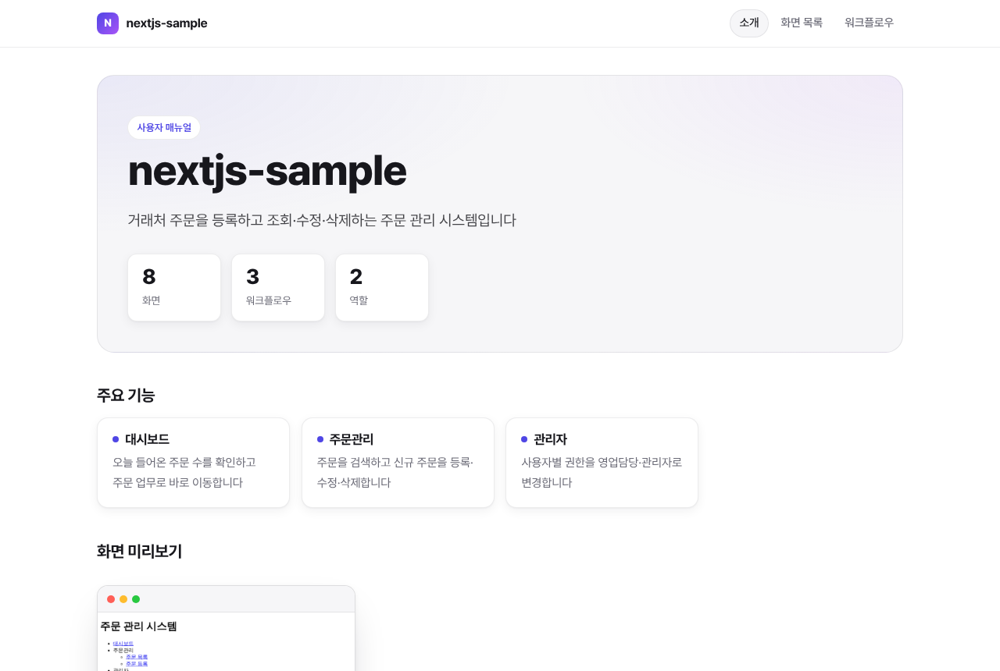
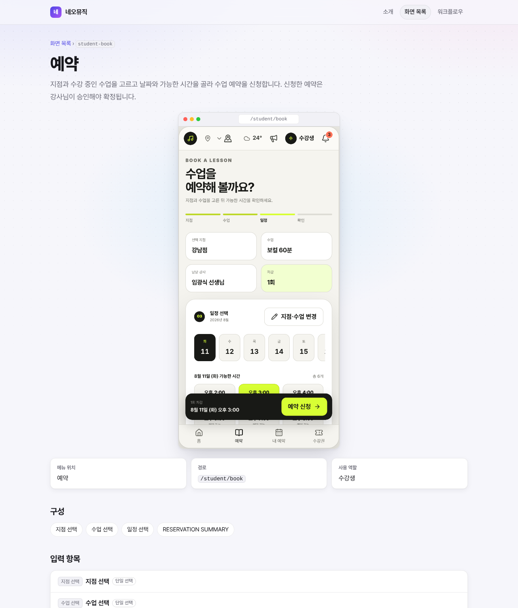
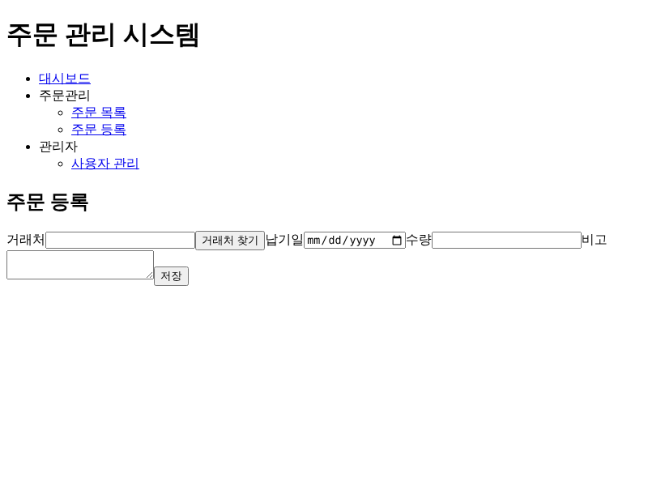

# docent

[한국어](README.md)

docent is a Claude Code plugin that reads a web app's source code and writes a **screen list, a user manual for each screen, a project introduction, and workflows**. If you allow it, docent also starts the app and adds **screenshots and short GIFs** of each screen in use. It exports HTML, README, PDF and PPT. Every statement points to the source it came from (`file:line`). Anything the source cannot confirm is marked `[확인 필요]` (needs review).



| Screen manual | Screen in use |
| --- | --- |
|  |  |

<sub>These examples come from the sample app in this repo (`fixtures/nextjs-sample`). Run `npm run demo` to rebuild them. The demo is in Korean; set `language: en` for English output.</sub>

## Install

```
/plugin marketplace add kwangtaeko/tgx-docent
/plugin install docent@tgx-docent
```

Run `/docent` in your project. docent shows you the screen list and asks you to confirm it, then analyzes each screen. Next it shows its plan for installing and starting the app; if you agree, it starts the app and takes screenshots. Finally it builds the output.

## Output

- `.docent/out/html/index.html` — introduction, screen list, a manual page for each screen (screenshot and GIF), and workflows
- `.docent/out/README.md` — an introduction for first-time readers
- `.docent/out/UserManual.pdf`, `.pptx` — PDF and PPT (on request; the file name is `output.title` without spaces, `사용자매뉴얼.pdf` by default in Korean)
- `.docent/review.md` — items that need review (write your answer and run `/docent-analyze` again)

Pick a preset for your audience:

- `delivery`: cover, table of contents and revision history
- `handover`: keeps source references and source file lists
- `portfolio`: public-facing, focused on the introduction and GIFs

In `.docent/config.yaml`, pick the language (`language: ko | en`) and a color theme (`output.theme: indigo | blue | emerald | rose | slate`). Set the language before analyzing screens, so the screen descriptions are written in it too. Button names and messages shown on screen are quoted as they appear, not translated.

Several apps, such as a user site and an admin site, can also go into one manual. Each app is analyzed on its own (`--workspace <name>`), and the root `config.yaml` lists them under `combine` to merge them.

When the code changes, `/docent-update` redoes only the screens that changed.

## Supported stacks

| Stack | Screen list | Screenshots and GIFs |
| --- | --- | --- |
| Next.js (App and Pages Router), React Router (v6, v7, `flatRoutes()`) and Remix v2, Vue Router and Nuxt, SvelteKit — including apps inside a monorepo | detector (script) | starts the app, or uses a URL you give |
| Spring MVC (JSP, Thymeleaf), Django and Flask, PHP, other JS routers | agent exploration with per-stack hints (`skills/docent/references/stacks/`) | starts the app, or uses a URL you give |
| ASP.NET WebForms | agent exploration with hints | URL only (needs IIS and Windows) |
| Desktop apps (Electron, Tauri, including menu-switched screens) | agent exploration | not supported (source only) |

The run guide covers npm, pnpm, yarn, docker compose, Maven, Gradle, Django and Flask (`skills/docent/references/run-guide.md`). Records of running docent on real repositories (a personal site, a desktop-app monorepo and a menu-permission business app) are in `docs/field-tests/`.

## Good to know

- While analyzing, your source is sent to the model API of the agent you use. The plugin itself sends nothing anywhere
- docent never reads secret files such as `.env`, `appsettings*.json`, `web.config` or key files (a hook blocks them during analysis). It stores only the names of environment variables, never secret values such as account passwords
- docent does not change your project's files. It writes only to `.docent/`
- docent runs install and start commands only after you approve them (`docent run approve`). It installs Playwright and Chromium for screenshots into `~/.cache/docent/runtime` only after you agree. Record with test accounts and test data
- Requires Node.js 20.10 or later
- Command-line messages follow `language` in `config.yaml`. Set `DOCENT_LANG=en` (or `ko`) to choose them yourself; running `init` with `DOCENT_LANG=en` also starts the outputs in English
- Other agents (such as Codex) can copy `skills/docent/` and follow `SKILL.md`. They don't get the secret-file hook, so they rely on the rules in `SKILL.md` alone

## Development

```bash
npm install
npm test
npm run build
npm run demo
```

- `npm test` — run all tests
- `npm run build` — rebuild the CLI bundle (`skills/docent/scripts/dist`). Run it and commit the result whenever you change the source
- `npm run demo` — rebuild the README demo assets (`docs/assets/`)

The design is in `docs/superpowers/specs/2026-10-13-docent-design.md` and the implementation plans are in `docs/superpowers/plans/`. MIT license.
