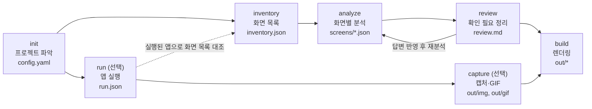

# docent 설계 문서

> 1.0 구현과 다른 곳은 코드·`skills/docent/SKILL.md`·`references/`가 우선합니다(이후 더한 것: `view` 화면, 데스크톱 앱은 소스만으로, 산출물은 `.docent/media/`·`.docent/out/`, 레포 구조는 `skills/docent/` 아래). 이 문서는 설계 당시 기록입니다.

> 작성일: 2026-10-13 · 상태: 승인 대기
> 이 문서는 `docs/PLAN.md`(초기 기획서)를 대체합니다. 두 문서가 다르면 이 문서를 따릅니다.
> "(설계자 결정)"이 붙은 항목은 사용자가 정한 것이 아니라 설계 과정에서 기본값으로 정한 것이며, 근거를 함께 적었습니다.

## 1. 무엇을, 왜 만드는가

**docent**는 누구나 설치해서 쓰는 공개 에이전트 플러그인입니다(레포 `tgx-docent`, 명령어 `/docent`). 처음 보는 **웹앱 프로젝트**의 소스를 읽고, 가능하면 앱을 직접 띄워 화면을 캡처해서, 사람이 바로 검토·배포할 수 있는 **산출물 묶음**을 만듭니다.

- 매뉴얼·화면 목록·소개 문서는 필요하지만 개발이 끝난 뒤 손으로 쓰고, 유지보수 중엔 거의 갱신되지 않습니다.
- 기존 AI 문서 도구는 README·API 문서 같은 개발자용 문서에 머물거나, 실행 중인 앱을 캡처하는 데서 끝납니다. 2026-10 기준 조사한 유사 도구(claude-manual-skill, Screen Browser, Manual & Documentation Builder 등)는 HTML 하나만 내거나, 근거 표기가 없거나, 전체 화면 커버리지를 보장하지 않습니다.

**docent의 차별점**

1. **빠짐없는 화면 목록** — 화면을 하나도 놓치지 않는 것이 출발점
2. **정확성 장치** — 모든 서술에 소스 근거, 모르는 것은 `[확인 필요]`
3. **산출물 세트** — 화면 목록·매뉴얼·소개·워크플로우·README·GIF를 한 번에
4. **여러 출력 형식과 용도 프리셋** — HTML·PDF·PPT, 납품·인수인계·포트폴리오

## 2. 성공과 실패

**성공** (사용자 표현): 화면 목록과 매뉴얼이 **실제 코드와 정확히 맞고**, 워크플로우가 **실제 흐름과 맞아떨어질 때** "계속 쓰겠다"고 느낍니다.

**목표**

- 처음 보는 웹앱 프로젝트에서 설정 수정 없이 명령 몇 개로 산출물 묶음을 얻는다
- 화면 누락 0, 근거 없는 서술 0
- 코드가 바뀌면 바뀐 화면만 다시 분석·캡처한다

**비목표**

- 개발자용 기술 문서(설치·빌드 방법, API 레퍼런스, 아키텍처 문서)
- 모바일 앱·데스크톱 앱 (이후 확장 대상, 지금은 설계만 막지 않도록)
- 나레이션·자막·편집이 들어간 영상
- 사람 검토 없이 바로 납품 가능한 완성본
- SaaS 호스팅, 수익화

**반목표** (기술적으로 돌아가도 이렇게 되면 실패)

- 소스에 없는 기능·버튼·업무 규칙을 그럴듯하게 써 넣는다
- 실패한 녹화를 그럴듯한 GIF로 내보낸다
- 비밀값이나 실데이터가 산출물·캡처에 그대로 찍힌다
- 사용자 동의 없이 대상 프로젝트에서 설치·실행 명령을 돌린다
- 대상 레포의 기존 파일(README 등)을 덮어쓴다

## 3. 사용자와 용도

- **사용자**: 산출물을 써야 하는 SI/SM 개발자, 매뉴얼 없는 시스템을 인수한 유지보수 담당자, 사이드 프로젝트에 소개·가이드를 붙이고 싶은 개인 개발자
- **용도** — 세 가지 모두 지원하며, 분석 결과는 하나로 두고 출력 시 **용도 프리셋**만 바꿉니다.

| 프리셋 | 받는 사람 | 특징 |
| --- | --- | --- |
| `delivery` (납품용) | 고객사·발주처 | 표지·목차·개정 이력, 근거 주석 제거, `[확인 필요]` 남아 있으면 경고 |
| `handover` (인수인계용) | 팀 내부 | 근거 주석·`[확인 필요]`·화면 파일 경로 유지 |
| `portfolio` (포트폴리오용) | 외부 공개 | 소개·README·GIF 중심, 화면 상세는 요약 |

## 4. 산출물

| 산출물 | 내용 | 형식 |
| --- | --- | --- |
| 화면 목록 | 전체 화면의 ID·이름·경로·메뉴 위치·권한·요약 | HTML, PDF, PPT, (Markdown) |
| 화면별 매뉴얼 | 화면 목적, 입력 항목, 버튼 동작, 안내 메시지, 캡처 이미지, 조작 GIF | HTML, PDF, PPT |
| 프로젝트 소개 | 시스템 한 줄 소개, 주요 기능, 사용자 역할, 메뉴 구조 | HTML, PDF, PPT |
| 워크플로우 | 사용자가 화면을 오가며 일을 처리하는 흐름 (예: 목록 → 등록 → 저장 → 목록) — 업무 단위별 Mermaid 다이어그램과 단계 설명 | HTML, PDF, PPT |
| 소개 README | 처음 보는 사람에게 "이 시스템이 무엇을 하는가"를 설명하는 README (개발자용 설치 문서 아님). 대표 화면 GIF 포함 | Markdown |
| 화면 조작 GIF | 주요 화면별 5~15초 조작 장면 | GIF |

- **워크플로우**는 개발 설계 문서가 아니라 사용자 관점의 흐름입니다. 화면 간 이동(링크·리다이렉트·라우터 이동)과 버튼 동작을 근거로 구성하며, 근거 없는 연결은 그리지 않습니다. (2026-10-17 추가: 메뉴에 있는 화면(`menuPath`)으로 옮겨 가는 단계도 메뉴 이동 연결로 인정하고 점선으로 구분합니다. 메뉴 권한형 업무 앱에서 메뉴를 넘나드는 업무를 적기 위함)
- README는 대상 레포의 기존 README.md를 덮어쓰지 않고 `.docent/out/README.md`에만 만듭니다.

## 5. 전체 흐름



| 명령 | 하는 일 | 주체 |
| --- | --- | --- |
| `/docent` | 첫 실행: 아래 단계를 순서대로, 필요한 곳에서만 사용자 확인 | 전체 |
| `/docent-init` | 프로젝트 구조 파악, `.docent/config.yaml` 생성 | 스크립트 + 에이전트 |
| `/docent-inventory` | 화면 목록 수집·확인 → `inventory.json` | 스크립트 + 에이전트 |
| `/docent-analyze [화면ID \| all]` | 화면별 분석 → `screens/*.json`, `review.md` | 에이전트 |
| `/docent-run` | 앱 실행 (6장) | 에이전트 + 스크립트 |
| `/docent-capture [화면ID \| all]` | 캡처·GIF (7장) | 스크립트 (+ 시나리오 작성은 에이전트) |
| `/docent-build [preset] [format...]` | 렌더링 → `out/` | 스크립트 |
| `/docent-update` | 변경된 화면만 재분석·재캡처·재렌더링 | 스크립트 + 에이전트 |

**핵심 원칙: 같은 입력이면 같은 결과가 나와야 하는 일은 스크립트, 해석은 에이전트.** 에이전트 결과는 반드시 JSON으로 저장되고, 이후 단계(렌더링·재캡처)는 LLM 없이 다시 돌릴 수 있어야 합니다.

## 6. 화면 목록 (inventory)

사용자 결정: **스크립트는 화면 목록까지만 뽑고, 화면 내용 해석은 전부 에이전트가 합니다.** 범용(스택을 미리 정하지 않음)이어야 하므로 목록 수집은 세 겹으로 합니다. (설계자 결정)

1. **알려진 프레임워크 감지기 (스크립트)** — 파일 기반 라우팅이나 라우트 선언이 정형화된 프레임워크는 스크립트가 결정적으로 뽑습니다. 첫 지원 대상: Next.js(App/Pages Router), React Router, Vue Router·Nuxt, SvelteKit. 감지기는 `{ detect(), listScreens() }` 인터페이스를 가진 독립 모듈이라 커뮤니티가 추가할 수 있습니다.
2. **에이전트 탐색 (감지기가 없거나 불완전할 때)** — 에이전트가 라우트 정의·컨트롤러·템플릿 디렉터리를 읽어 화면 후보를 `inventory.json` 형식으로 씁니다. 각 화면은 `evidence`(라우트가 정의된 파일:라인)를 가져야 하며, 없으면 목록에 넣지 않습니다.
3. **실행 중인 앱 대조 (앱이 떠 있을 때)** — 스크립트가 시작 URL부터 같은 도메인 링크를 따라가 도달한 경로를 모으고, 목록과 비교해 "목록에 없는데 화면에서 발견됨 / 목록에 있는데 도달 못 함"을 `review.md`에 기록합니다.

목록은 사용자에게 한 번 보여 주고 확인받습니다(추가·제외는 `config.yaml`의 `screens.include` / `screens.exclude`). 확인된 `inventory.json`은 이후 단계의 기준이며, 에이전트가 임의로 화면을 더하거나 빼지 않습니다. 예외는 아래 하위 화면뿐입니다.

**화면 단위** (설계자 결정)

- 기본 단위는 **라우트(URL) 하나 = 화면 하나**(`kind: page`)입니다.
- **팝업·모달**은 자체 입력 항목이나 버튼 동작이 있을 때만 별도 화면(`kind: modal` 또는 `popup`)으로 셉니다. 확인창·알림창처럼 메시지와 확인 버튼뿐인 것은 부모 화면의 `messages`로 처리합니다.
- **탭·단계별 입력(wizard)**은 별도 화면이 아니라 부모 화면의 섹션(`sections[]`)으로 다룹니다.
- **권한별로 달라지는 화면**은 한 화면으로 두고, 권한에 따른 차이를 `roles`와 항목별 조건으로 적습니다.
- 하위 화면은 analyze 단계에서 발견되며, `parentId`와 `evidence`(열리는 지점)를 가지고 `inventory.json`에 `source: agent`로 추가됩니다. 추가된 하위 화면은 `review.md`에 모아 사용자 확인을 받습니다.
- 하위 화면 캡처는 부모 화면에서 여는 동작을 시나리오로 실행해 찍습니다.

**화면 ID 규칙** (설계자 결정): 라우트에서 결정적으로 만듭니다. `/order/[id]/edit` → `order-id-edit`, `/` → `home`. 하위 화면은 `<부모ID>--<이름>`(예: `order-new--customer-search`). 충돌 시 `-2`, `-3`을 붙입니다. 화면 코드 체계가 있는 프로젝트(예: `ORD1010`)는 `config.yaml`의 `screens.idMap`으로 덮어씁니다. ID는 한번 정해지면 라우트가 바뀌지 않는 한 유지되어야 합니다(증분 갱신·캡처·GIF 연결의 키).

**inventory.json 항목**: `id`, `route`, `files`(화면 관련 파일 목록 — 페이지 파일과 그 파일이 직접 import하는 프로젝트 내부 파일, 1단계까지), `menuPath`(알 수 있을 때), `evidence`, `source`(`detector:<이름>` | `agent` | `crawl`), `kind`(`page` | `modal` | `popup` | `view`), `parentId`(하위 화면만).

## 7. 화면 분석 (analyze)

- 화면마다 `screen-analyzer` 서브에이전트가 `inventory.json`의 `files`에서 시작해 필요한 만큼 따라가며 읽고 `screens/<id>.json`을 씁니다.
- 서브에이전트가 없는 에이전트(병렬 실행 불가)에서는 같은 프롬프트로 화면을 하나씩 순차 처리합니다. SKILL.md에 두 경로를 모두 적습니다.
- 분석 결과는 JSON 스키마(`schemas/screen.schema.json`)로 검증하고, 실패하면 해당 화면만 다시 분석합니다.

**화면 JSON** — 모든 서술 항목은 `evidence`를 가지며, 해석이 들어간 항목은 `confidence`를 가집니다.

```json
{
  "id": "order-new",
  "title": { "value": "주문 등록", "evidence": "app/order/new/page.tsx:12" },
  "route": "/order/new",
  "menuPath": { "value": ["주문관리", "주문 등록"], "evidence": "components/nav.tsx:40" },
  "purpose": { "value": "거래처별 신규 주문을 등록한다", "evidence": "app/order/new/page.tsx:12-80", "confidence": "high" },
  "roles": [{ "value": "영업담당", "evidence": "middleware.ts:22", "confidence": "medium" }],
  "fields": [
    { "label": "거래처", "type": "select", "required": true, "evidence": "app/order/new/page.tsx:41", "confidence": "high" }
  ],
  "actions": [
    { "label": "저장", "effect": "입력값 검증 후 주문을 저장하고 목록으로 이동한다", "navigatesTo": "order-list",
      "evidence": "app/order/new/actions.ts:15", "confidence": "medium" }
  ],
  "messages": [{ "text": "저장되었습니다.", "when": "저장 성공", "evidence": "app/order/new/actions.ts:30" }],
  "unknowns": ["저장 버튼 노출 조건이 DB 권한 테이블에 의존함"],
  "readFiles": ["app/order/new/page.tsx", "app/order/new/actions.ts", "components/nav.tsx"],
  "sourceHash": "sha256:…"
}
```

- `actions[].navigatesTo`가 워크플로우의 재료입니다. 워크플로우는 `navigatesTo`로 이어지는 화면 연결을 업무 단위로 묶어 만들고, 업무 단위 이름과 설명만 에이전트가 붙입니다.
- `readFiles`: 분석 중 실제로 읽은 프로젝트 파일 목록. `sourceHash`는 이 목록의 내용 해시입니다. (설계자 결정 — inventory의 `files`는 1단계 import까지라 깊은 공통 컴포넌트 변경을 놓치기 때문)

**대규모 프로젝트** (설계자 결정): 1.0은 화면 **300개 규모**까지 감당합니다.

- 화면 분석은 묶음 단위로 돌립니다(동시 실행 기본 4개, `config.yaml`의 `analyze.concurrency`).
- **이어서 하기**: 이미 `screens/<id>.json`이 있고 `sourceHash`가 같은 화면은 건너뛰므로, 중단 후 같은 명령을 다시 실행하면 남은 화면부터 이어집니다.
- **사전 안내**: 분석·캡처 전에 대상 화면 수와 대략의 소요 시간을 보여 주고, 화면이 50개를 넘으면 진행 여부를 확인받습니다.
- **범위 좁히기**: 메뉴나 경로 접두어로 일부만 처리할 수 있습니다(`/docent-analyze --path /order`, `screens.include`).
- 렌더링은 화면 수와 관계없이 몇 초 안에 끝나야 하며, 300개 라우트를 자동 생성한 합성 픽스처로 스크립트 단계 성능을 테스트합니다.

## 8. 앱 실행 (run) — 사용자 결정: 단계별 방식

스택별 실행 힌트는 `references/run-guide.md`에 둡니다: npm/pnpm/yarn, docker compose, Python(Django·Flask), Maven·Gradle(Spring Boot, 내장 톰캣 JSP 포함). ASP.NET WebForms는 IIS·Windows가 필요해 자동 실행 대상에서 제외하고 처음부터 주소 받기(2번)로 안내합니다.

1. **자동 실행 시도**: 에이전트가 `package.json` 스크립트, README, `docker-compose.yml`, `Procfile` 등을 읽고 실행 계획(설치 명령, 실행 명령, 포트, 필요한 환경변수)을 만들어 **사용자에게 보여 주고 동의를 받은 뒤** 실행합니다. 동의 없이 설치·실행 명령을 돌리지 않습니다.
2. **실패 시 안내 후 주소 받기**: 비밀값·외부 서비스·DB·로그인 계정이 필요하거나 실행이 실패하면, 무엇이 부족한지 구체적으로 알려 주고 사용자가 직접 띄운 앱의 주소(`DOCENT_BASE_URL`)를 받습니다.
3. **성공한 방법 저장**: 성공한 실행 방법은 `.docent/run.json`에 저장하고, 다음부터 스크립트(`run.mjs`)가 LLM 없이 같은 방법으로 띄웁니다(헬스체크 URL 응답 대기 포함). 비밀값은 저장하지 않고 환경변수 이름만 적습니다.
4. **끝내 안 되면**: 캡처·GIF·실행 앱 대조만 건너뛰고, 나머지 산출물은 소스만으로 만듭니다. 산출물에는 캡처가 없다는 사실을 표시합니다.

로그인이 필요한 앱은 `config.yaml`에 로그인 방식(폼 라벨과 계정 환경변수 이름)을 적거나, 사용자가 브라우저에서 직접 한 번 로그인한 세션 상태(Playwright storage state)를 `.docent/auth/`에 저장해 재사용합니다. `.docent/auth/`와 `run.json` 외 비밀이 들어갈 수 있는 파일은 `.docent/.gitignore`로 커밋을 막습니다.

**`.docent/` 커밋 정책** (설계자 결정): `config.yaml`, `run.json`, `inventory.json`, `screens/`, `scenarios/`, `review.md`는 커밋 대상(팀이 증분 갱신·재녹화 상태를 공유). `auth/`, `out/`은 기본 `.gitignore` — 캡처·GIF에 실데이터가 찍힐 수 있으므로 산출물 배포는 사용자가 명시적으로 합니다.

## 9. 캡처와 GIF (capture)

- **캡처**: `capture.mjs`가 Playwright로 각 화면 라우트에 접속해 전체 화면 스크린샷을 `out/img/<id>.png`로 저장합니다. 동적 세그먼트가 있는 라우트는 에이전트가 목록 화면에서 실제 ID를 골라 `scenarios/<id>.json`에 기록합니다.
- **GIF 시나리오**: `scenario-writer` 서브에이전트가 화면 JSON의 `fields`·`actions`·`messages`를 보고 시나리오를 씁니다. 요소는 셀렉터가 아니라 라벨·role로 찾고, 단계마다 `evidence`를 가집니다. 근거 없는 동작은 넣지 않습니다.
- **녹화**: `record.mjs`가 시나리오를 실행하며 일정 간격으로 프레임을 캡처하고, 순수 JS 인코더(gifenc)로 GIF를 만듭니다. 기본값 너비 800px, 10fps, 2MB 이하.
- **재녹화**: 시나리오는 파일로 남으므로 LLM 없이 스크립트만으로 다시 녹화합니다. 화면의 `sourceHash`가 바뀌면 시나리오를 낡음으로 표시하고 다시 씁니다. 사람이 고친 시나리오는 `"locked": true`로 재작성을 막습니다.
- **실패 처리**: 단계가 실패하면 그 화면의 GIF는 만들지 않고, 실패 단계와 스크린샷을 `review.md`에 남깁니다. 시나리오의 라벨을 실제 화면에서 못 찾은 것은 화면 JSON과 실제 화면이 어긋났다는 신호로 함께 기록합니다.
- **GIF 대상 화면 기본값** (설계자 결정): `actions`가 있는 화면(등록·수정·검색 등). `config.yaml`의 `gif.screens`로 지정·제외할 수 있습니다.
- **데이터 보호**: 녹화·캡처는 테스트 계정·테스트 데이터 환경에서 하도록 안내하고, `config.yaml`의 `mask.selectors`(예: 주민번호·전화번호 칼럼)는 캡처 전에 블러 처리합니다. 결과물은 로컬에만 저장합니다.

## 10. 렌더링 (build)

- 입력: `inventory.json`, `screens/*.json`, `review.md`, `out/img`, `out/gif`. 같은 입력이면 같은 출력(타임스탬프는 `config.yaml`의 기준일 또는 git 커밋 시각 사용).
- **HTML**: 정적 사이트(`out/html/`) — 목차, 소개, 화면 목록, 화면별 페이지, 워크플로우 페이지. 이미지·GIF는 폴더로 함께 두고, 외부 CDN에 의존하지 않습니다(Mermaid 포함 모든 자산 로컬 번들).
- **PDF**: 같은 HTML을 인쇄용 CSS와 함께 Playwright `page.pdf()`로 출력. Playwright가 없으면 PDF만 건너뛰고 안내합니다.
- **PPT**: pptxgenjs로 생성. 표지 → 소개 → 메뉴 구조 → 워크플로우(다이어그램 PNG) → 화면별 1~2장(캡처 + 입력 항목·버튼 요약).
- **Mermaid → PNG**: PPT·PDF용 다이어그램 이미지는 Playwright로 로컬 Mermaid 번들을 렌더링해 만듭니다.
- **README**: Markdown 템플릿 렌더링. 대표 GIF는 `out/gif/` 상대 경로로 링크.
- **템플릿**: 기본 템플릿은 JS 템플릿 모듈로 제공하고, 사용자 교체 템플릿 지원은 이후로 미룹니다. (설계자 결정 — 외부 템플릿 엔진 의존성을 피하기 위해)
- **문서 언어**: 한국어 기본, `config.yaml`의 `language: en`으로 영어. 문체 규칙은 `references/writing-style.md`(사용자 관점, 존댓말, 용어 통일).

## 11. 정확성 장치 (사용자 결정: 기존 기획서의 장치 유지)

1. 모든 서술 항목은 `evidence`(파일:라인 또는 파일:함수)를 가집니다. 근거가 없으면 쓰지 않습니다.
2. 해석이 들어간 항목은 `confidence`(high·medium·low)를 가집니다. low는 본문에 `[확인 필요]`로 표시하고 `review.md`에 모읍니다.
3. 소스에 없는 기능·버튼·업무 규칙은 쓰지 않습니다. `screen-analyzer` 프롬프트에 금지 사례를 명시합니다.
4. `handover` 프리셋 출력은 근거를 주석으로 남겨 검토자가 원문을 바로 찾게 합니다. `delivery`는 근거 주석을 제거합니다.
5. 소개·README의 요약 서술도 근거 화면 ID 목록을 가지며, `confidence: low` 화면만으로 뒷받침되는 기능은 넣지 않습니다.
6. 렌더링 전에 `validate.mjs`가 검사하고, 위반이 있으면 빌드를 멈춥니다. (설계자 결정)
   - 스키마 위반, `evidence` 누락
   - 근거의 파일이 존재하고 라인 범위가 파일 안에 있는지
   - 문자열 그대로 나오는 항목(입력 항목 라벨, 버튼 라벨, 안내 메시지)은 그 텍스트가 근거 위치 ±5줄 안에 실제로 있는지 (i18n 키를 쓰는 프로젝트는 키→문구 파일까지 따라가 확인)
   - 해석 항목(`purpose`, `effect`, 역할)은 근거 위치 존재까지만 자동 검사하고, 내용은 `confidence`와 사람 검토에 맡깁니다

**review.md 형식** (설계자 결정): 화면 ID별 섹션, 항목마다 `- [ ] [화면ID] 항목 — 이유 (근거)` 체크박스. 사용자가 답을 적으면 다음 analyze가 반영합니다. DB 의존 항목(메뉴·권한 테이블)은 사용자가 `.docent/inputs/`에 덤프(CSV)를 넣으면 그걸 근거로 채웁니다.

## 12. 보안

- 플러그인 자체는 외부 전송을 하지 않습니다. 단, 분석 중 소스가 사용 중인 에이전트의 모델 API로 전송된다는 점을 README에 명시합니다.
- **비밀 파일 차단**: 마스킹을 스캔 스크립트에서만 하면 에이전트가 원본을 직접 읽을 수 있으므로, 다음 두 겹으로 막습니다.
  - `.env*`, `appsettings*.json`, `web.config`, `*.pem`, `*.key` 등 비밀 파일 패턴(`config.yaml`의 `secrets.paths`로 확장)은 SKILL.md·에이전트 프롬프트에서 **읽기 금지**로 지정하고, Claude Code에서는 플러그인이 제공하는 `PreToolUse` 훅으로 해당 경로 읽기를 차단합니다.
  - 실행 계획에 필요한 환경변수는 `.env.example` 같은 예시 파일이나 코드의 `process.env.X` 참조에서 **이름만** 수집합니다.
- 실행 동의: 설치·실행 명령은 항상 사용자 확인 후 실행합니다.
- 캡처·GIF 데이터 보호는 9장 참고.

## 13. 증분 갱신 (update)

- 화면별 `sourceHash`(= 화면 JSON의 `readFiles` 내용 해시)가 바뀐 화면만 재분석합니다. git이 없는 프로젝트에서도 동작하도록 해시를 기준으로 하고, git diff는 "어떤 파일이 바뀌었는지" 빠르게 좁히는 보조 수단으로만 씁니다. (설계자 결정)
- 라우트 추가·삭제는 inventory를 다시 수집해 반영합니다.
- 재분석된 화면은 캡처를 다시 찍고, GIF 시나리오는 낡음으로 표시합니다.
- 공통 컴포넌트처럼 여러 화면이 읽은 파일이 바뀌면 그 파일을 `readFiles`에 가진 화면이 모두 재분석 대상이 됩니다.

## 14. 기술 기본값 (설계자 결정, 사용자 승인)

| 영역 | 선택 | 이유 |
| --- | --- | --- |
| 런타임 | Node.js 20+, ESM | Claude Code 환경에 거의 항상 있고 Playwright가 Node 기반 |
| 브라우저 | Playwright(Chromium), 스크립트에서 직접 제어 | 재현 가능한 캡처·녹화 |
| GIF | 프레임 캡처 + gifenc | ffmpeg 불필요 |
| PDF | Playwright `page.pdf()` | 추가 의존성 없음, HTML과 동일 내용 |
| PPT | pptxgenjs | 순수 JS, 편집 가능한 .pptx |
| 다이어그램 | Mermaid (로컬 번들) | 한 원천으로 세 형식 |
| 스키마 검증 | JSON Schema + 경량 검증기(번들) | |
| 배포 | 스크립트(Playwright 제외)를 esbuild로 번들해 레포에 커밋. Playwright 패키지와 Chromium은 첫 run·capture·PDF 시 사용자 동의 후 사용자 캐시(`~/.cache/docent/runtime/`, 버전 고정)에 설치 — 대상 프로젝트와 플러그인 디렉터리는 건드리지 않음. 이미 설치된 Playwright가 있으면 재사용 | 플러그인 설치 시 `npm install`이 자동 실행되지 않고, 플러그인 디렉터리는 업데이트 때 교체될 수 있음 |
| 테스트 | `node:test` + 픽스처 골든 테스트 | 테스트 의존성 없음 |
| 줄바꿈 | `.gitattributes`로 LF 고정 | Node 스크립트 shebang·CRLF 문제 방지 |

Playwright가 없거나 설치를 거절하면 run·capture·PDF만 건너뛰고 HTML·PPT·README는 정상 생성합니다.

## 15. 레포 구조

```
tgx-docent/
├─ .claude-plugin/{plugin.json, marketplace.json}
├─ skills/docent/
│  ├─ SKILL.md                 # 진입점: 전체 흐름, 단계별 규칙, 서브에이전트 없을 때 경로
│  ├─ references/{schema.md, writing-style.md, run-guide.md}
│  ├─ schemas/{inventory,screen,scenario,run}.schema.json
│  └─ scripts/                 # 번들된 결과물(dist)과 소스(src)
│     └─ src/{init,inventory,crawl,validate,run,capture,record,render,update}.mjs
│        detectors/{nextjs,react-router,vue,sveltekit}.mjs
│        renderers/{html,pdf,pptx,readme}.mjs
├─ agents/{screen-analyzer.md, route-explorer.md, scenario-writer.md}
├─ commands/                   # /docent, /docent-init ...
├─ hooks/                      # 비밀 파일 읽기 차단 PreToolUse 훅
├─ fixtures/                   # 샘플 웹앱 + 기대 산출물(골든)
├─ docs/
├─ AGENTS.md, CLAUDE.md, README.md
```

**크로스 에이전트**: Claude Code는 마켓플레이스로 설치합니다. Codex 등 SKILL.md를 읽는 에이전트는 `skills/docent/`를 복사해 씁니다(훅 차단이 없으므로 프롬프트 규칙에 의존한다는 점을 README에 적습니다).

## 16. 작업 단계 (설계자 결정)

모든 산출물이 1.0 범위이지만, 각 단계가 끝날 때마다 실제로 쓸 수 있는 결과가 나오도록 순서를 정합니다.

| 단계 | 내용 | 끝났을 때 얻는 것 |
| --- | --- | --- |
| M1 기반 | 레포 세팅, 스키마, 픽스처(Next.js 샘플 웹앱 1개, 화면 6~8개: 로그인·목록·등록·상세·권한 분기 포함)와 기대 산출물 수작업 작성 | "좋은 결과"의 기준 |
| M2 소스 기반 산출물 | init, inventory(Next.js 감지기 + 에이전트 탐색), analyze, review, validate, HTML·README 렌더링 | 캡처 없는 HTML 산출물 세트 |
| M3 실행·캡처 | run(단계별), crawl 대조, capture, GIF 시나리오·녹화 | 캡처·GIF가 들어간 산출물 |
| M4 형식·프리셋 | PDF, PPT, 3개 프리셋, update(증분) | 전체 형식 |
| M5 범용성 | React Router·Vue·SvelteKit 감지기, 감지기 없이 에이전트 탐색만으로 도는 **Spring MVC(JSP) 픽스처**(실행·캡처까지), **ASP.NET WebForms 픽스처**(소스 분석만), 스택별 탐색 힌트(`references/stacks/`) | 범용성·SI 레거시 검증 |
| 1.0 | 실전 적용(개인 레포 몇 개), README(한/영)·데모 GIF, 마켓플레이스 등록 | 공개 릴리스 |

## 17. 검증 기준

| 기준 | 측정 | 목표 |
| --- | --- | --- |
| 화면 누락 | 픽스처 기대 inventory 대비 | 0건 |
| 입력 항목 정확도 | 라벨·타입·필수 여부를 골든 JSON과 비교 (LLM 결과이므로 릴리스 전 수동 + 자동 비교 리포트) | 전 항목 일치 |
| 근거 없는 서술 | `validate.mjs` | 0건 |
| 확인 필요 처리 | DB 의존·권한 분기 화면의 `[확인 필요]` 표시 | 해당 화면 전부 |
| 워크플로우 | 픽스처의 기대 화면 연결과 비교 | 기대 연결 전부 포함, 근거 없는 연결 0 |
| 첫 실행 | 설정 수정 없이 `/docent` 한 번으로 산출물 생성 (실행 동의 제외) | 성공 |
| 자동 실행 | Next.js 픽스처를 `/docent-run`이 스스로 띄움 | 성공 |
| GIF | 픽스처 등록·목록 화면 시나리오 실행 / LLM 없이 재녹화 | 전부 성공 / 같은 단계·같은 결과 메시지 |
| 결정성 | 같은 JSON으로 build 두 번 | HTML·README 바이트 동일 |

**CI**: 스크립트 단계(감지기, 검증, 렌더링)는 골든 테스트로 자동 실행. LLM 단계는 스키마·근거 검사만 자동, 서술 품질은 릴리스 전 수동 리뷰. GIF는 픽스처를 띄워 저장된 시나리오가 끝까지 통과하는지만 검사.

**SI 레거시 스택 지원 방침** (설계자 결정): JSP/Spring과 WebForms는 전용 감지기 대신 **에이전트 탐색 + 스택별 힌트 문서**로 지원합니다. 범용 구조가 실제로 레거시에도 통하는지가 M5의 검증 대상이며, 결과가 부족하면 그때 전용 감지기를 추가합니다. Spring을 비지원 스택 대표 픽스처로 고른 이유는 SI 수요가 크고 Linux에서도 실행·캡처까지 검증할 수 있기 때문입니다.

## 18. 빌더에게 맡기는 것

- 스크립트 내부 구조, 함수 분리, 번들 설정
- HTML·PPT의 시각 디자인(단, 외부 CDN 금지와 인쇄용 CSS는 지킬 것)
- 크롤러의 깊이 제한·타임아웃 등 세부 값
- 픽스처 앱의 구체적 업무 도메인

## 19. 아직 열려 있는 것 (구현을 막지는 않음)

- 레포 위치: 현재 계정 vs 변경 예정 계정명 — 마켓플레이스 등록(1.0) 전에 결정
- 사내 소스 실전 적용 가능 여부(회사 보안 정책) — 불가하면 개인 프로젝트·공개 샘플로 대체

## 추가 (2026-10-17): 여러 앱을 한 매뉴얼로

- 앱마다 작업 폴더 `.docent/apps/<이름>/`(CLI `--workspace <이름>`)에서 지금의 흐름(init~capture)을 그대로 따로 진행한다. 비밀 파일 차단 세션 표시는 루트 `.docent/.session` 하나, 훅은 앱 작업의 `secrets.paths`도 읽는다
- 루트 `.docent/config.yaml`의 `combine: [{ workspace, title? }]`이 있으면 `build`가 앱마다 검증한 뒤 합친다: 화면 ID는 `<작업>.<ID>`, 메뉴 경로·기능 메뉴·워크플로우 이름 앞에 앱 제목, 화면 목록은 앱별 줄로 나눈다. 언어·프리셋·테마·제목은 루트 설정
- 앱을 넘나드는 워크플로우는 다루지 않는다(검증이 앱마다라 근거를 확인할 수 없음)
